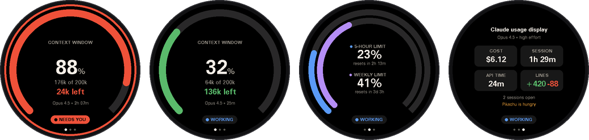
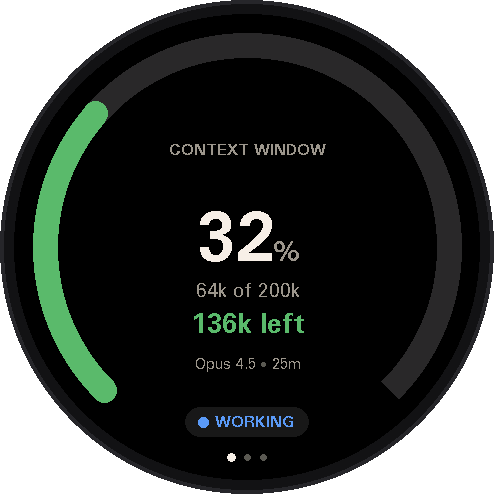
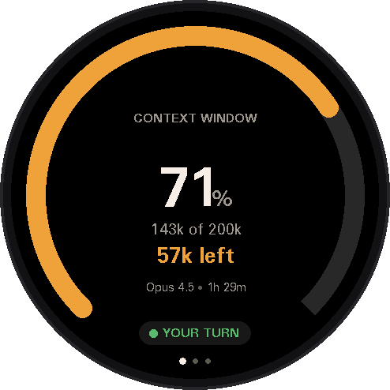
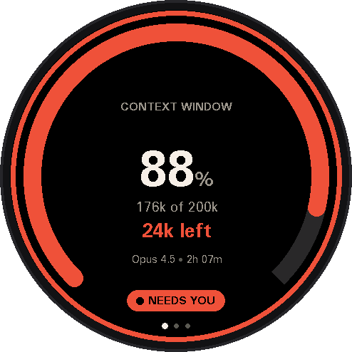
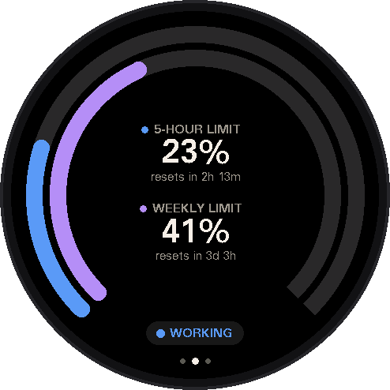
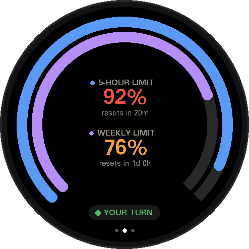
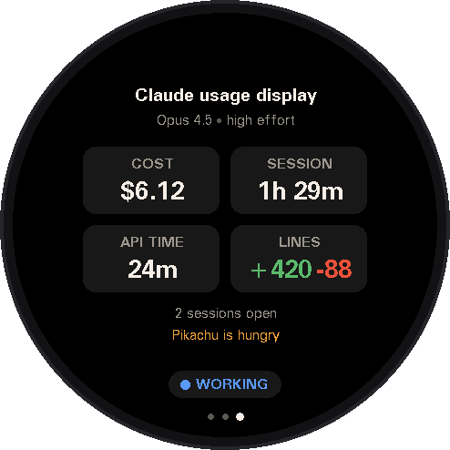
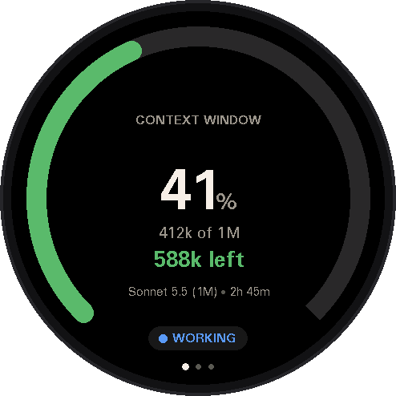

# Claude dashboard: your Claude Code usage on the TamaPoke

Plug the board into your work computer over USB and it becomes a desk display
for [Claude Code](https://code.claude.com): how full the context window is,
how much is left, how long the session has run, your plan's 5-hour and weekly
limits, the session cost, and whether Claude is working, done, or waiting for
you. Your Pokémon stays on the board. Swipe up to visit it.



*These pictures are the firmware's own drawing code, rendered on a PC
(`tools/claude_preview/build.sh`). They are not mock-ups.*

## What each screen shows

| Screen | Shows |
|---|---|
| **Context** | Percent of the context window used, tokens used of the window size, **tokens left**, the model and session time. The ring is green below 60 %, amber up to 80 %, red above. |
| **Plan limits** | Outer ring: **5-hour** limit. Inner ring: **weekly** limit. Each shows its percentage and when it resets. The numbers turn amber at 70 % and red at 90 %. With an API key (no plan limits) it shows the session cost instead. Behind a Claude apps gateway it shows your spend limit. |
| **Session** | Session name (or project), model and effort, then cost, session time, time spent waiting on the API, and lines added and removed. Below that: how many Claude Code sessions are open, and a note if your Pokémon needs something ("Pikachu is hungry"). |

Every page has a **status pill** at the bottom:

- **WORKING** (blue): Claude is responding or running tools.
- **YOUR TURN** (green): Claude finished. Your move.
- **NEEDS YOU** (red, with a red rim around the whole screen): Claude is waiting
  for a permission or an answer.
- **ERROR** (red): the turn ended with an API error, such as a rate limit.
- **IDLE** / **NO SESSION**: a session is open but quiet, or no session is open.

With several Claude Code sessions open, the board shows the one that most needs
you: NEEDS YOU first, then ERROR, WORKING, YOUR TURN, and IDLE. Ties go to the
session that moved most recently.

| | | |
|---|---|---|
|  |  |  |
|  |  |  |
|  |  |  |

## How it works

```
Claude Code ──status line JSON──► claude_monitor.py statusline ─┐
            ──hook events───────► claude_monitor.py hook ────────┤  ~/.claude/tamapoke/
                                                                 ▼
                                  claude_monitor.py serve ──USB serial, every 2 s──► board
```

Claude Code already computes all of these numbers. It hands them to any
[status line](https://code.claude.com/docs/en/statusline) command as JSON, and
runs [hooks](https://code.claude.com/docs/en/hooks) when Claude starts working,
asks for permission or finishes. `tools/claude_monitor.py` records both, and
its `serve` command streams one line to the board every 2 seconds:

```
CLAUDE v=1 st=1 ctx=124300 max=200000 pct=62 cost=421 dur=4980 h5=23 r5=8040 w7=41 r7=273600 model=Opus%204.5 ...
```

**No API key, token or account access is needed.** Nothing leaves your
computer except over the USB cable to the board. The protocol is described in
`claudemon.h`.

## Setup

You need Python 3 and the board flashed with this firmware.

**1. Flash the firmware** as usual (see the [README](README.md#ide-setup--build)).
The dashboard is part of the normal build. There is no flag to set.

**2. Install pyserial** on the work computer:

```bash
pip install pyserial
```

**3. Hook it into Claude Code.** One command adds the status line and hooks to
`~/.claude/settings.json`, after saving a backup next to it:

```bash
python3 tools/claude_monitor.py install
```

If you already had a status line, it keeps showing. The bridge runs it and
prints its output in place of its own. Then restart Claude Code, or open a new
session.

**4. Plug the board in and leave the bridge running:**

```bash
python3 tools/claude_monitor.py serve
```

It finds the board by itself. If it doesn't, or you have several ESP32 boards,
pass the port (for example `--port COM5` or `--port /dev/cu.usbmodem1101`).
When the first line arrives, the board switches to the dashboard.

To check what would be sent without a board:

```bash
python3 tools/claude_monitor.py status
```

To see the screens on the board without Claude Code:

```bash
python3 tools/claude_monitor.py demo
```

To undo step 3 (your previous status line comes back):

```bash
python3 tools/claude_monitor.py uninstall
```

On Windows, use `py` or `python` where these examples say `python3`. The
commands that `install` writes into the settings use the full path of the
Python that ran it, so they keep working from any folder.

## On the board

- **Swipe left / right**: next or previous page. Swiping left past the last page
  goes to your Pokémon.
- **Tap**: next page.
- **Swipe up or down**: back to your Pokémon.
- **From the Pokémon screen, swipe right**: back to the dashboard (while the PC
  is connected; otherwise it opens the Pokédex, as before).
- After **one minute untouched** on the Pokémon screen, the board goes back to
  the dashboard by itself.
- It also comes forward on its own when the bridge connects, and when Claude
  needs you, unless you are in a game, a menu or a dialog.

**Screen and sound:**

- While Claude works, the screen stays lit. When nothing happens, it dims after
  90 seconds like the rest of the game, which protects the AMOLED.
- To limit burn-in, the whole dashboard also shifts by up to 2 pixels every 2
  minutes.
- Chimes: **NEEDS YOU** and **ERROR** always chime. **YOUR TURN** chimes only
  when Claude worked for 30 seconds or more, which is when you have probably
  looked away. The chimes use the game's volume. Mute them from the settings
  screen (swipe down on the Pokémon screen).
- A screen you turned off with PWR stays off: no wake-up and no sound.
- If the PC goes quiet (bridge stopped, cable pulled), the dashboard shows
  "Link to the PC lost". After 2 minutes it hands the screen back to your
  Pokémon.

## Good to know

- **Plan limits only exist for claude.ai Pro, Max and similar plans.** Claude
  Code reports them after the first reply in a session. With an API key, the
  limits page shows the session cost instead.
- **"Working" after Esc:** Claude Code doesn't run its Stop hook when you
  interrupt a turn. The status falls back to IDLE after 5 minutes without
  activity.
- **"Needs you" during an approved command:** no hook fires when you approve a
  permission, so NEEDS YOU stays until that tool finishes.
- **Sprite uploads:** `tools/send_sd.py` and the web installer need the serial
  port. Stop `serve` (Ctrl+C) while you use them.
- **Text is English only.** Session names with accents are shown without them
  (Café → Cafe). Characters with no ASCII form, such as Japanese, are dropped.
- **Without the hooks** (if you set up only the status line by hand), the board
  works out WORKING from the numbers moving. It cannot show NEEDS YOU or ERROR.
- **Start it with your computer:** run `serve` from a login item, Task Scheduler
  (use `pythonw` on Windows to hide the console) or a systemd user service. It
  waits for the board and reconnects when you plug it back in.

## Files

| File | What |
|---|---|
| `claudemon.h` / `claudemon.cpp` | Protocol parser, countdowns, alerts, and the formatted contents of each frame. Plain logic, tested on the PC (`test/test_claudemon.cpp`). |
| `claudeui.h` / `claudeui.cpp` | Draws the pages (Arduino_GFX + U8g2 fonts). |
| `TamaPoke.ino` | Serial `CLAUDE` lines, gestures, auto-open, wake-ups and chimes (search for "Claude dashboard"). |
| `tools/claude_monitor.py` | PC bridge: `install`, `serve`, `status`, `demo`, `uninstall` (and `statusline` / `hook`, which Claude Code runs). Tests: `test/test_claude_monitor.py`. |
| `tools/claude_preview/` | Renders the screens on a PC from the firmware code: `build.sh` makes the sample images in `docs/claude-monitor/`, and `build.sh --live` renders what your own data looks like right now. |
