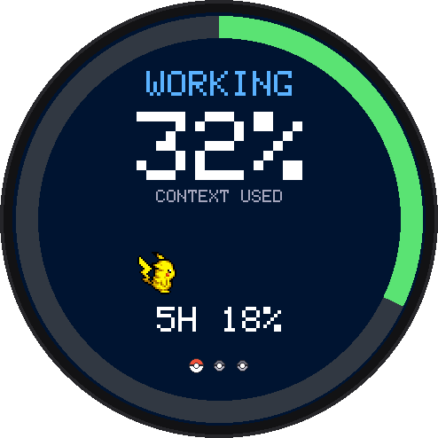
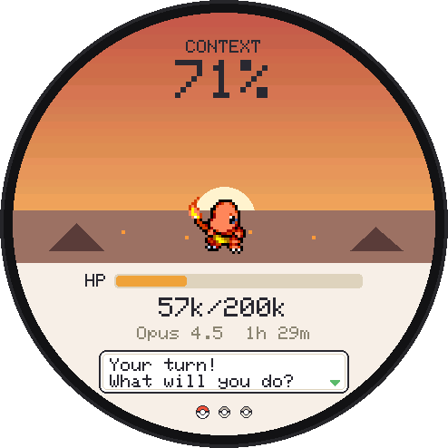
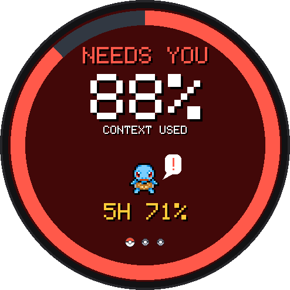
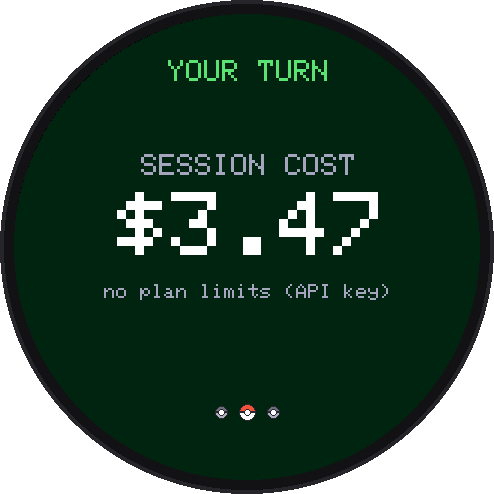
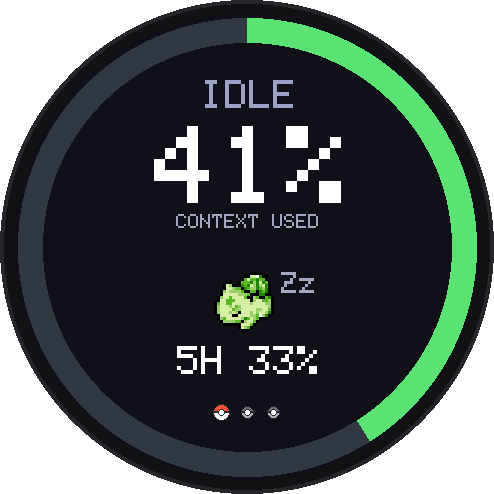
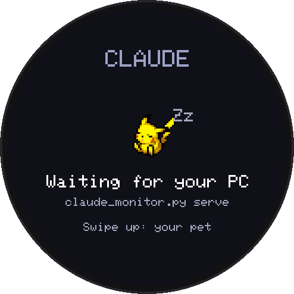

# Claude dashboard: your Claude Code usage on the TamaPoke

Plug the board into your work computer over USB and it becomes a desk display
for [Claude Code](https://code.claude.com): how full the context window is,
how much is left, how long the session has run, your plan's 5-hour and weekly
limits, the session cost, and whether Claude is working, done, or waiting for
you. It is laid out to be read from across a desk: the screen is tinted by
what Claude is doing, and each page shows only a few numbers, drawn large.
Your Pokémon stays on the main page and acts out what Claude is doing.


*These pictures are the firmware's own drawing code, with the real sprites,
rendered on a PC (`tools/claude_preview/build.sh`). They are not mock-ups.*

## What each screen shows

| Screen | Shows |
|---|---|
| **Main** | The status word, then the percent of the **context window used** in big digits, inside a thick **ring** that fills as the window does: green under half, yellow, then red from 80 %. Below, your Pokémon acting out the status, and the **5-hour limit** (yellow from 70 %, red from 90 %). With an API key it shows the session cost there instead. |
| **Plan limits** | The **5-hour** and **weekly** limits: big percentage, thick bar and reset countdown for each, in the same colours. With an API key (no plan limits) it shows the session cost instead. Behind a Claude apps gateway it shows your spend limit. |
| **Session** | **Cost** and **time** in big digits, **lines** added (green) and removed (red), then the model and effort, how many sessions are open, and a note when your Pokémon needs something ("Pikachu is hungry"). |

Every page is tinted by what Claude is doing, with the status word at the top,
so you can tell from across the room:

| Claude | Screen | Your Pokémon (main page) |
|---|---|---|
| working | blue, WORKING | paces back and forth |
| finished | green, YOUR TURN | strikes a pose now and then |
| waiting for a permission or an answer | red, NEEDS YOU: the main page **flashes**, the other pages get a thick **red rim** | nods at you, with a "!" bubble |
| API error (rate limit, ...) | orange, ERROR | looks hurt |
| quiet | grey, IDLE | sleeps (Zz) |

The page markers at the bottom are little Poké Balls.

With several Claude Code sessions open, the board shows the one that most needs
you: NEEDS YOU first, then ERROR, WORKING, YOUR TURN, and IDLE. Ties go to the
session that moved most recently.

| | | |
|---|---|---|
|  |  |  |
|  |  |  |
|  |  |  |

## How it works

```
Claude Code ──status line JSON──► claude_monitor.py statusline ─┐
            ──hook events───────► claude_monitor.py hook ────────┤  ~/.claude/tamapoke/
                                                                 ▼
                                  claude_monitor.py serve ──USB serial, every 2 s──► board
```

Claude Code already computes all of these numbers. It hands them to any
[status line](https://code.claude.com/docs/en/statusline) command as JSON, and
runs [hooks](https://code.claude.com/docs/en/hooks) when Claude starts working,
asks for permission or finishes. `tools/claude_monitor.py` records both, and
its `serve` command streams one line to the board every 2 seconds:

```
CLAUDE v=1 st=1 ctx=124300 max=200000 pct=62 cost=421 dur=4980 h5=23 r5=8040 w7=41 r7=273600 model=Opus%204.5 ...
```

**No API key, token or account access is needed.** Nothing leaves your
computer except over the USB cable to the board. The protocol is described in
`claudemon.h`.

## Setup

You need Python 3 and the board flashed with this firmware.
The dashboard is part of the normal build (see the
[README](README.md#ide-setup--build)). There is no flag to set.

### As a Claude Code plugin (easiest, and the same on every computer)

The bridge ships as the `tamapoke-monitor` plugin in this repository. The
plugin brings the hooks and starts the bridge in the background with each
Claude Code session, so there is nothing to leave running by hand. On each
computer:

```bash
claude plugin marketplace add Quinner64/TamaPoke-Claude
claude plugin install tamapoke-monitor@tamapoke
```

(or, inside Claude Code: `/plugin install tamapoke-monitor --marketplace Quinner64/TamaPoke-Claude`).
Then, in a new session, run **`/tamapoke-monitor:setup`** once. It adds the
status line (a plugin cannot set one by itself), checks for pyserial and
offers to install it, and starts the bridge.

| Command | Does |
|---|---|
| `/tamapoke-monitor:setup` | One-time setup on this computer |
| `/tamapoke-monitor:bridge stop` | Frees the USB port, for flashing or `tools/send_sd.py` |
| `/tamapoke-monitor:bridge start` / `status` / `demo` | What they say |
| `/tamapoke-monitor:bridge autostart off` | Stop starting the bridge with each session |

Only one bridge runs at a time, however many sessions you open: it holds a
lock in `~/.claude/tamapoke/`, and logs to `serve.log` there. The status line
runs a copy of the bridge kept in `~/.claude/tamapoke/bin/`, refreshed at each
session start, because the plugin's own folder changes with every update.
Hooks run through `bash` (Git Bash on Windows, which Claude Code uses anyway).
To remove it: `claude plugin uninstall tamapoke-monitor@tamapoke`, then
`python3 plugins/tamapoke-monitor/scripts/claude_monitor.py uninstall` to take
the status line out again.

### By hand

**1. Install pyserial** on the work computer:

```bash
pip install pyserial
```

**2. Hook it into Claude Code.** One command adds the status line and hooks to
`~/.claude/settings.json`, after saving a backup next to it:

```bash
python3 tools/claude_monitor.py install
```

If you already had a status line, it keeps showing. The bridge runs it and
prints its output in place of its own. Then restart Claude Code, or open a new
session.

**3. Plug the board in and leave the bridge running:**

```bash
python3 tools/claude_monitor.py serve
```

It finds the board by itself. If it doesn't, or you have several ESP32 boards,
pass the port (for example `--port COM5` or `--port /dev/cu.usbmodem1101`).
When the first line arrives, the board switches to the dashboard.

To check what would be sent without a board:

```bash
python3 tools/claude_monitor.py status
```

To see the screens on the board without Claude Code:

```bash
python3 tools/claude_monitor.py demo
```

To undo step 2 (your previous status line comes back):

```bash
python3 tools/claude_monitor.py uninstall
```

On Windows, use `py` or `python` where these examples say `python3`. The
commands that `install` writes into the settings use the full path of the
Python that ran it, so they keep working from any folder.

## On the board

- **Swipe left / right**: next or previous page. Swiping left past the last page
  goes to your Pokémon.
- **Tap**: next page.
- **Swipe up or down**: back to your Pokémon.
- **From the Pokémon screen, swipe right**: back to the dashboard (while the PC
  is connected; otherwise it opens the Pokédex, as before).
- After **one minute untouched** on the Pokémon screen, the board goes back to
  the dashboard by itself.
- It also comes forward on its own when the bridge connects, and when Claude
  needs you, unless you are in a game, a menu or a dialog.

**Screen and sound:**

- While Claude works, the screen stays lit. When nothing happens, it dims after
  90 seconds like the rest of the game, which protects the AMOLED.
- The Context page is animated like the game's main screen, at the same frame
  rates. The two cards are redrawn only when a number on them changes.
- To limit burn-in, everything drawn over the background shifts by up to 2
  pixels every 2 minutes.
- Chimes: **NEEDS YOU** and **ERROR** always chime. **YOUR TURN** chimes only
  when Claude worked for 30 seconds or more, which is when you have probably
  looked away. The chimes use the game's volume. Mute them from the settings
  screen (swipe down on the Pokémon screen).
- A screen you turned off with PWR stays off: no wake-up and no sound.
- If the PC goes quiet (bridge stopped, cable pulled), the dashboard shows
  "Link to the PC lost". After 2 minutes it hands the screen back to your
  Pokémon.

## Good to know

- **Plan limits only exist for claude.ai Pro, Max and similar plans.** Claude
  Code reports them after the first reply in a session. With an API key, the
  limits page shows the session cost instead.
- **"Working" after Esc:** Claude Code doesn't run its Stop hook when you
  interrupt a turn. The status falls back to IDLE after 5 minutes without
  activity.
- **"Needs you" during an approved command:** no hook fires when you approve a
  permission, so NEEDS YOU stays until that tool finishes.
- **Sprite uploads:** `tools/send_sd.py` and the web installer need the serial
  port. Stop `serve` (Ctrl+C) while you use them.
- **Text is English only.** Session names with accents are shown without them
  (Café → Cafe). Characters with no ASCII form, such as Japanese, are dropped.
- **Without the hooks** (if you set up only the status line by hand), the board
  works out WORKING from the numbers moving. It cannot show NEEDS YOU or ERROR.
- **Start it with your computer:** run `serve` from a login item, Task Scheduler
  (use `pythonw` on Windows to hide the console) or a systemd user service. It
  waits for the board and reconnects when you plug it back in.

## Files

| File | What |
|---|---|
| `claudemon.h` / `claudemon.cpp` | Protocol parser, countdowns, alerts, and the formatted contents of each frame. Plain logic, tested on the PC (`test/test_claudemon.cpp`). |
| `claudeui.h` / `claudeui.cpp` | Draws the pages for reading at a distance: status-tinted dark screen, context ring, big pixel-font numbers, the pet. |
| `scene.h` / `scene.cpp`, `pmddraw.h` | The game's biome scene and PMD sprite drawing, moved out of `TamaPoke.ino` unchanged so the game and the dashboard share them. |
| `TamaPoke.ino` | Serial `CLAUDE` lines, gestures, auto-open, wake-ups and chimes (search for "Claude dashboard"). |
| `plugins/tamapoke-monitor/` | The Claude Code plugin: `scripts/claude_monitor.py` is the PC bridge (`install`, `serve`, `status`, `demo`, `uninstall`, `stop`, `autostart`, and `statusline` / `hook` / `ensure`, which Claude Code runs); `hooks/hooks.json`, the `setup` and `bridge` skills, and `scripts/run.sh`, which finds a Python for the hooks. `.claude-plugin/marketplace.json` at the repo root lists it. Tests: `test/test_claude_monitor.py`. |
| `tools/claude_monitor.py` | Wrapper that runs the plugin's bridge, so the old commands keep working. |
| `tools/claude_preview/` | Renders the screens on a PC from the firmware code and the real sprites: `build.sh` makes the sample images and GIFs in `docs/claude-monitor/`, and `build.sh --live` renders what your own data looks like right now. |
